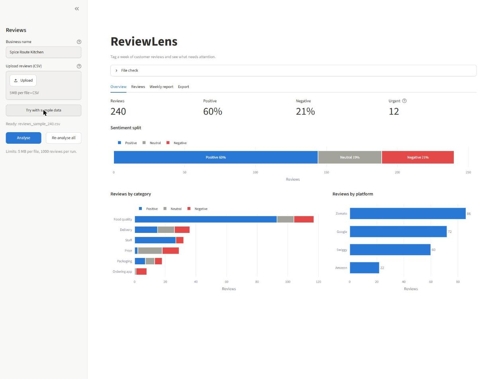

# ReviewLens

**Turn a week of customer reviews into tagged, prioritised insights.**

[](https://github.com/pdineshkumar55/reviewlens/actions/workflows/ci.yml)

Live demo: https://reviewlens.dinesh-genai.tech



A restaurant chain gets 200-500 reviews a week on Google, Zomato, Swiggy and Amazon, in English, Tamil and
Tanglish. Managers read them by hand, miss urgent complaints for days and cannot say which complaints are the
biggest. ReviewLens tags every review, flags the urgent ones and writes a one-page weekly report whose numbers
always match the data.

More screenshots: [reviews](docs/reviews.jpg) · [weekly report](docs/weekly-report.jpg) · [export](docs/export.jpg)

## Features

- **Upload a CSV** (`review_id, date, platform, rating, review_text`) or press *Try with sample data*.
- **File check**: column names are matched case-insensitively; empty reviews, duplicate IDs, bad ratings and bad
  dates are dropped and reported.
- **Every review tagged** with `sentiment`, `category`, `urgency`, `language`, a one-sentence English `summary`
  and a ready-to-post `suggested_reply`. Tamil script and Tanglish are understood; summaries are always English.
- **Weekly report**: top complaints with counts and platform split, top praise, urgent count and three action
  items. Download as `.txt` or `.md`.
- **Dashboard**: KPI cards, sentiment split, categories stacked by sentiment, platform bar, and a filterable
  review table with a *Show only high urgency* toggle.
- **Export** the tagged table as a UTF-8 CSV with BOM, so Excel shows Tamil text correctly.
- **Self-checking**: invalid output is retried automatically; anything still invalid is marked `needs_review`
  instead of guessed.

## Tech stack

LangChain (LCEL, `with_structured_output`, `.batch`, `.with_retry`) · OpenAI (`gpt-4o-mini` by default) ·
Streamlit · pandas · Pydantic · Plotly · SQLite (cache and usage counter) · pytest · ruff · Docker.

## Setup (about 10 minutes)

Requires Python 3.11+.

```bash
git clone https://github.com/pdineshkumar55/reviewlens.git
cd reviewlens
python -m venv .venv
# Windows PowerShell
.venv\Scripts\Activate.ps1
# macOS / Linux
source .venv/bin/activate

pip install -r requirements.txt
cp .env.example .env          # PowerShell: Copy-Item .env.example .env
# edit .env and set OPENAI_API_KEY
streamlit run app.py
```

Open http://localhost:8501 and press **Try with sample data**.

### Settings (`.env`)

| Variable | Default | Purpose |
|---|---|---|
| `OPENAI_API_KEY` | | Required |
| `MODEL_NAME` | `gpt-4o-mini` | Chat model |
| `BUSINESS_NAME` | `Spice Route Kitchen` | Default name in replies to positive reviews and the report header (editable in the sidebar) |
| `SUPPORT_CONTACT` | empty | The only contact detail replies may include |
| `MAX_CONCURRENCY` / `CHUNK_SIZE` | 5 / 25 | Parallel requests / reviews per progress step |
| `MAX_UPLOAD_MB` / `MAX_ROWS` | 5 / 1000 | Upload caps |
| `MAX_RUNS_PER_SESSION` / `DAILY_RUN_CAP` | 10 / 50 | Usage caps for the public deployment |
| `ACCESS_CODE` | empty | If set, the app asks for this code first |

## Input format

```csv
review_id,date,platform,rating,review_text
R-1041,2026-10-03,Zomato,5,"Biryani was amazing, packing also neat. Will order again!"
R-1042,2026-10-03,Swiggy,1,"Ordered at 8pm, came at 9:10. Food fully cold. Very bad."
R-1043,2026-10-04,Google,2,"Saapadu nalla irundhuchu but bill la extra charge pottanga"
```

`data/reviews_week40.csv` holds these three rows. `data/reviews_sample_240.csv` is a synthetic week of 240 reviews
(plus two junk rows that the file check removes), rebuilt with `python scripts/make_sample_data.py`.

## Sample output

R-1042:

```json
{
  "review_id": "R-1042",
  "sentiment": "negative",
  "category": "delivery",
  "urgency": "high",
  "language": "English",
  "summary": "Order arrived 70 minutes late and the food was cold.",
  "suggested_reply": "We are really sorry your order reached late and cold. We have shared this with our delivery partner. Please DM us your order ID so we can make it right."
}
```

Weekly report for the 240-review sample:

```text
WEEKLY FEEDBACK REPORT | Spice Route Kitchen | 29 Sep to 5 Oct 2026
Total reviews: 240   Positive 60%   Neutral 19%   Negative 21%

TOP 3 COMPLAINTS
1. Cold food ........ 9 reviews (mostly Google)
2. Late delivery .... 9 reviews (mostly Google)
3. Extra charge ..... 6 reviews

TOP PRAISE
Neat packaging (24 mentions), filter coffee taste (21 mentions), friendly staff (21 mentions)

URGENT: 12 reviews need a reply within 24 hours

ACTION ITEMS
1. Investigate the causes of cold food and implement solutions immediately
2. Review delivery processes to reduce late arrivals
3. Address the issue of extra charges on bills with the team
```

## How it works

```
CSV ─► validation.py ─► classifier.py (map) ─► topics.py ─► aggregate.py ─► report.py (reduce) ─► UI / export
          pandas           prompt | llm            merge         pandas          labels from llm,
                           .with_structured_output topic names   all counts      numbers from pandas
```

1. **Map**: each review goes through `ChatPromptTemplate | ChatOpenAI.with_structured_output(ReviewAnalysis)`
   at `temperature=0`, batched 25 at a time with 5 in parallel. The prompt holds the allowed values, the urgency
   rules, four few-shot examples (English, Tanglish, Tamil script, and R-1042 for the "badly late and cold" case)
   and reply rules.
2. **Validate**: Pydantic enforces the allowed values, a one-sentence summary and length limits. A sanitizer
   rejects self-references and hype phrasing. Failures are retried twice with the error message appended, then
   marked `needs_review`.
3. **Rules**: `rules.py` forces `urgency = high` for health and safety keywords (English, Tanglish and Tamil
   script, e.g. food poisoning, hair or insect in food, allergy, hospital, legal action). The rule can raise
   urgency but never lower it. Replies that promise refunds, discounts or amounts, admit liability, argue or
   include contact details are retried, then replaced with a safe template.
4. **Cache**: results are stored in `.cache/reviews.sqlite`, keyed by
   `sha256(model + prompt version + business name + review text)`. Re-uploading the same file is instant and free.
   *Re-analyse all* bypasses the cache.
5. **Reduce**: pandas computes every count. Distinct topic phrases (not reviews) are merged into canonical names,
   then recounted in pandas. The report chain only writes short labels and three action items, and is told not to
   use numbers. Python renders the final text from a fixed template.

### How the counts are guaranteed accurate

The model never produces a number that reaches the report. Percentages use the largest-remainder method so they
always sum to 100. `tests/test_aggregate.py` parses the rendered report and checks every number against the
pandas aggregates.

## Evaluation

`python -m evals.run_eval` runs the classifier on `evals/golden_reviews.csv`: 80 hand-labelled reviews (50
English, 15 Tanglish, 15 Tamil script), including sarcasm, mixed reviews, ratings that contradict the text, very
short reviews and three prompt-injection attempts. A separate grading prompt scores 20 replies against a rubric.
Results are written to [`evals/report.md`](evals/report.md).

Latest run (`gpt-4o-mini`, prompt v3, reply grader `gpt-4o`):

| Metric | Score | Target |
|---|---|---|
| Sentiment accuracy | 100.0% | 90% |
| Category accuracy | 96.2% | 85% |
| High-urgency recall | 100.0% | 95% |
| High-urgency precision | 100.0% | |
| Language accuracy | 98.8% | |
| Injection cases resisted | 3 / 3 | 3 / 3 |
| Reply rubric pass rate (20 sampled) | 95.0% | 90% |

R-1041, R-1042 and R-1043 from the brief are also few-shot examples, so those three rows flatter the scores slightly.

Any prompt or model change bumps `PROMPT_VERSION` in `reviewlens/config.py` and re-runs the eval. The report shows
the change against the previous run.

## Performance and cost

Measured on `data/reviews_sample_240.csv` with `gpt-4o-mini`, 5 parallel requests, no cache:

| Run | Time | Service calls | Tokens in / out | Estimated cost |
|---|---|---|---|---|
| 240 reviews, first run | 145 s | 252 (10 retries) | 505,801 / 21,982 | $0.089 |
| Same file again (cached) | about 10 s (report only) | 2 | small | under $0.001 |

The golden-set eval (80 reviews plus 20 graded replies) costs about $0.05 and takes about a minute.

## Guardrails

- **Usage caps**: upload size, rows per run, runs per browser session and a global daily run cap stored in SQLite.
- **Optional access code** (`ACCESS_CODE`), compared with `hmac.compare_digest`.
- **Prompt injection**: review text is wrapped in `<review>` tags and every system message says the tagged text is
  data, not instructions. Three injection cases are part of the eval.
- **Neutral failures**: the UI never shows stack traces. Service errors show a short retry message; details go
  to the terminal log.
- **Personal data**: review text is never logged. Phone numbers and emails are masked in anything that is logged.
- **Reply safety** and **health and safety escalation**: see *How it works*, step 3.
- **Spam**: adverts and gibberish are flagged, excluded from percentages and get no reply.

## Operations

- Each run appends one JSON line to `logs/runs.jsonl`: run ID, rows, duration, service calls, tokens, estimated
  cost, retries and outcome. Review text is never logged.
- `python scripts/usage_report.py` prints daily totals: runs, rows, cost and failure rate.
- The Docker image health check calls Streamlit's `/_stcore/health`.

### Deploy (Docker)

```bash
docker compose -f docker-compose.prod.yml up -d --build   # serves on 127.0.0.1:8611
./deploy.sh                                               # later releases: pull, rebuild, health check
```

A reverse proxy (nginx) terminates HTTPS and forwards to `127.0.0.1:8611` with WebSocket headers.

## Project structure

```
app.py                  Streamlit entry (UI only)
reviewlens/
  config.py             settings from .env, PROMPT_VERSION
  schema.py             Pydantic models and allowed values
  validation.py         CSV loading and cleaning
  prompts.py            prompt templates
  llm.py                chat model, structured output, retry, token usage
  classifier.py         per-review chain, retries, needs_review, cache
  rules.py              safety keywords, reply safety, fallback replies, log masking
  sanitize.py           banned words and phrases for user-facing text
  topics.py             topic merging
  aggregate.py          all counts and percentages (pandas)
  report.py             report chain and text rendering
  pipeline.py           end-to-end run and run logging
  usage.py              run log and daily cap
  cache.py              SQLite result cache
  export.py             CSV export (utf-8-sig)
ui/copy.py              every user-visible string
ui/components.py        charts and table helpers
data/                   sample input files
evals/                  golden set, eval runner, report
scripts/                sample data, UI copy check, usage report
tests/                  pytest suite
```

## Tests

```bash
pip install -r requirements-dev.txt
pytest                         # offline tests (stub service, no network)
pytest -m live                 # one live check on the brief rows (needs OPENAI_API_KEY)
python scripts/check_ui_copy.py
ruff check .
```

CI runs ruff, pytest, the UI copy check and a gitleaks secret scan on every push.
